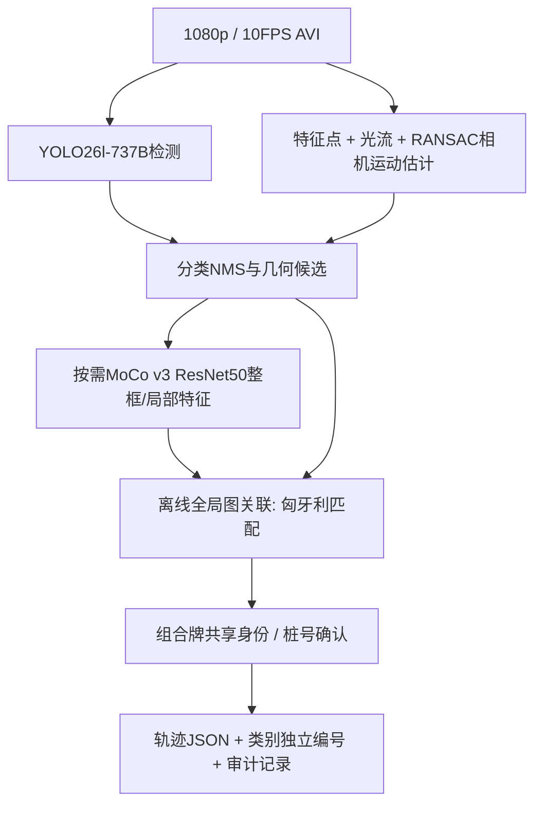

# 网络结构与算法

## 1. 系统不是一个端到端网络

真正的深度网络有两个：YOLO26检测网络和MoCo的ResNet50特征网络。GMC、NMS、候选筛选、匈牙利匹配和计数规则不是额外训练的神经网络，也没有联合端到端训练。当前算法不直接使用BoT-SORT或OC-SORT。

## 2. YOLO26l检测网络

固定实现为Ultralytics 8.4.146，模型为普通YOLO26l，**不是P2版本**。官方结构配置保存在`config/yolo26_official_v8.4.146.yaml`，保留其许可证和出处。`l`缩放系数为depth=1.0、width=1.0、max_channels=512；官方yaml中的1024通道等基础参数会经max_channels缩放/截断，不能把yaml基础值直接当作所有层的实际通道数。

下表完整列出官方配置的连接关系。重复数及模块内展开以固定版本parser为准，层号指yaml顶层模块，不是PyTorch展开后的全部层。

| 层号 | 输入 | 模块 | 功能/输出 |
|---|---|---|---|
| 0 | 输入图像 | Conv 3×3,s2 | P1/2 |
| 1 | 0 | Conv 3×3,s2 | P2/4 |
| 2 | 1 | C3k2 | 局部特征提取 |
| 3 | 2 | Conv 3×3,s2 | P3/8 |
| 4 | 3 | C3k2 | Backbone P3 |
| 5 | 4 | Conv 3×3,s2 | P4/16 |
| 6 | 5 | C3k2 | Backbone P4 |
| 7 | 6 | Conv 3×3,s2 | P5/32 |
| 8 | 7 | C3k2 | 高层特征 |
| 9 | 8 | SPPF | 多感受野汇聚 |
| 10 | 9 | C2PSA | 高层注意力特征 |
| 11 | 10 | nearest上采样×2 | 自顶向下融合 |
| 12 | 11、6 | Concat | 拼接P4 |
| 13 | 12 | C3k2 | 融合P4 |
| 14 | 13 | nearest上采样×2 | 继续上采样 |
| 15 | 14、4 | Concat | 拼接P3 |
| 16 | 15 | C3k2 | 检测P3/8 |
| 17 | 16 | Conv 3×3,s2 | 自底向上融合 |
| 18 | 17、13 | Concat | 融合P4 |
| 19 | 18 | C3k2 | 检测P4/16 |
| 20 | 19 | Conv 3×3,s2 | 下采样 |
| 21 | 20、10 | Concat | 融合P5 |
| 22 | 21 | C3k2 | 检测P5/32 |
| 23 | 16、19、22 | Detect | 三尺度分类与框回归 |

训练将COCO的80类检测输出适配为道路资产17类；类别顺序见`config/classes.json`，不可自行重排。训练原样保留one2many与one2one分支；历史开训前对四组box/cls分支做过梯度检查。当前交付推理明确使用**one2many＋NMS**，不是因为YOLO26支持免NMS就默认免NMS。`reg_max=1`来自官方结构，不应把旧YOLO的DFL结构直接套进来。

输入参数`imgsz=960`表示Ultralytics预处理尺度，不是将原视频强行改为960×960。1080p横屏且rect=true时会使用匹配步长的矩形网络输入；坐标最终还原到1920×1080原图。

## 3. MoCo v3 ResNet50外观网络

采用1000 epoch预训练权重，不在道路资产上微调。加载`module.base_encoder.*`，排除fc分类参数，将fc替换为Identity，使用eval模式。

| 阶段 | 结构 | 典型224输入的空间尺寸/通道 |
|---|---|---|
| 输入 | 资产紧框裁剪、等比例缩放、RGB填充 | 224×224×3 |
| stem | 7×7 Conv,s2 + BN/ReLU + maxpool,s2 | 56×56×64 |
| layer1 | 3个Bottleneck | 56×56×256 |
| layer2 | 4个Bottleneck | 28×28×512 |
| layer3 | 6个Bottleneck | 14×14×1024 |
| layer4 | 3个Bottleneck | 7×7×2048 |
| 汇聚 | 全局平均池化、fc=Identity | 2048维 |
| 输出 | L2归一化 | 单位特征向量 |

预处理：RGB除255，均值[0.485,0.456,0.406]、标准差[0.229,0.224,0.225]；填充RGB=(124,116,104)。相似度为归一化特征点积，即余弦相似度。它不是概率，也不是“80%确定同一资产”。

整框特征比较整个资产裁剪，不是对整个视频做特征；局部特征对大框的若干纵向区域裁剪，验证小框对应哪一部分。区域为[0,.5]、[.5,1]、[0,.67]、[.33,1]、[.2,.8]。

## 4. 几何与关联

GMC：原图转灰度并缩到960×540，最多600角点，Lucas–Kanade光流＋RANSAC部分仿射估计，平移缩放回原图。估计不足时使用单位变换，不代表该帧已精确补偿。

全局图节点为检测框，连接只向后、同类别且满足候选限制。基础参数：gap=5帧、birth_cost=.8、appearance_min=.5、geometry_weight=.25、appearance_weight=1.25、residual_base=3、min_observations=2。代价综合补偿后几何偏差、外观差异、尺寸变化及帧间隔，再用线性分配选择前后继并组成轨迹。不是某篇网络流论文的完整复现，不是任意长时间间隔的关联。

明确的相邻几何关联可不算MoCo；困难关联、断帧恢复和BS大小框验证按需请求特征。困难候选没有固定只取前三个的截断。路灯使用bottom-center几何锚点，关闭外观关联。

分类NMS：离散类IoU=.5，连续资产类IoU=.85并结合轴重叠；包含框还检查IOA、面积比和类别专用规则，不是只用一个IoU。BS相关包含关系可要求外观相似度≥.9，但仍需结合几何，不直接当物理身份真值。

BS共享身份需要实际完整框证据及局部一致性；上/下子牌交替出现但没有完整框时不强行合并。ZH规则为置信度≥.75连续3帧，且代码只在连续高置信度满足的帧保留，不向前补帧。HL/LH虽然是17类检测模型的一部分，但当前追踪明确排除。

所有规则以`runtime/*.py`为权威实现，本文解释其职责，不把规则误称成训练得到的新网络。
